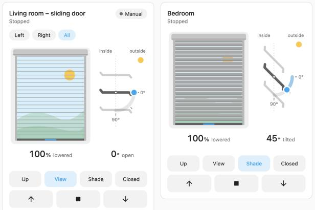
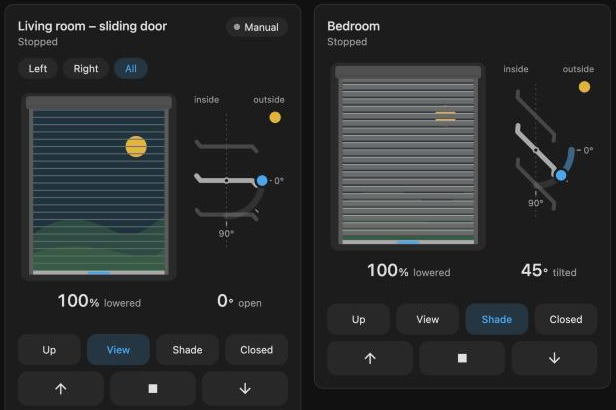

# Raffstore Card

A Home Assistant Lovelace card for **exterior venetian blinds** (raffstore, external blinds with tiltable slats).
Set the **height and the slat angle in one card**, visually: drag the window to lower or raise the blind, drag the slat profile to tilt the slats.

The built-in cover dialog shows two unrelated sliders, and most cover cards ignore tilt altogether. This card shows what the blind will actually look like before it moves.





## Features

- Drag the window to set the height; grab the handle at the tip of the slat (side view) and turn it to set the angle. The state is shown in words – open, tilted, closed – and in degrees.
- The window shows what you will see: open slats let the view through, closed slats form a wall.
- Target preview: a dashed line and dashed slats show the target, the current state stays visible.
- Height and angle can be adjusted together; the card sends after a short delay (`debounce`).
- Presets: up, view (slats horizontal), shade, closed – or your own.
- Several motors on one window (e.g. a sliding door with two blinds): control one, or all together.
- Optional automation lock (e.g. the lock switch of [Shadow Control](https://github.com/starwarsfan/shadow-control)): a manual move pauses the automation, the *Auto* pill resumes it.
- Keyboard accessible (arrow keys on the window and the slats), light and dark theme, English, Slovak and Czech.
- Works with any `cover` entity; tilt needs the `set_tilt_position` feature.

## Installation

### HACS (custom repository)

1. HACS → ⋮ → *Custom repositories* → add `https://github.com/damianmajercak/raffstore-card`, category *Dashboard*.
2. Install **Raffstore Card**, reload the browser.

### Manual

1. Download `raffstore-card.js` from the [latest release](https://github.com/damianmajercak/raffstore-card/releases).
2. Copy it to `/config/www/raffstore-card.js`.
3. *Settings → Dashboards → ⋮ → Resources* → add `/local/raffstore-card.js` as a *JavaScript module*.

## Configuration

```yaml
type: custom:raffstore-card
entity: cover.bedroom_blind
```

Two motors on one window, with an automation lock:

```yaml
type: custom:raffstore-card
name: Living room – sliding door
entities:
  - entity: cover.sliding_door_left
    name: Left
  - entity: cover.sliding_door_right
    name: Right
lock_entity: switch.shadow_control_living_room_lock
tilt_mode: immediate
presets:
  - name: Up
    position: 100
  - name: View
    position: 0
    angle: 0
  - name: Shade
    position: 0
    angle: 50
  - name: Privacy
    position: 0
    angle: 70
```

| Option | Default | Description |
|---|---|---|
| `entity` / `entities` | – | One or more `cover` entities. `entities` items can be a string or `{entity, name, open_time, close_time, tilt_time}`. |
| `name` | friendly name | Card title. |
| `lock_entity` | – | `switch` / `input_boolean`; `on` = automation paused. A manual move turns it on, the pill toggles it. |
| `tilt_mode` | `after_move` | When the slat angle is sent, see below. |
| `slat_profile` | `z` | Slat cross-section in the angle dial: `z` (e.g. Z90), `c` (e.g. C80) or `flat`. |
| `tilt_closed_angle` | `90` | Slat angle in degrees at tilt position 0 % (closed). |
| `tilt_open_angle` | `0` | Slat angle in degrees at tilt position 100 % (open, horizontal). |
| `presets` | built-in | List of `{name, position, angle \| tilt, icon}`; `position` and `tilt` use Home Assistant percent (position 100 = raised, tilt 100 = open). `false` hides presets. |
| `debounce` | `800` | Milliseconds after dragging before the command is sent. |
| `service` | – | Optional `domain.service` called instead of the cover services with `entity_id`, `position` and `tilt_position` (e.g. a script). |
| `open_time` | – | Full travel time up in seconds, or an entity whose state is that time. Only used to draw the move smoothly, see below. |
| `close_time` | – | Full travel time down (seconds or entity). |
| `tilt_time` | `0` | Slat turn from one end to the other (seconds or entity). |

### `tilt_mode`

Home Assistant has no single "move to height *and* angle" command – position and tilt are two service calls.

- **`after_move`** (default, works with any cover): the card sends the position, waits until the blind stops, then sends the tilt. The card has to stay open until the move ends.
- **`immediate`**: both commands are sent right away. Use this when the device queues a tilt that arrives during a move and applies it after the move (recommended for devices you control yourself, e.g. ESPHome).

When the height changes, the card keeps the angle you see: after lowering, the slats are turned back to the shown angle.

### Smooth movement

Time-based covers report their position only about once per second while moving, so the drawing would jump in steps. The card predicts the move between reports and treats every report as a correction that is blended in.

- With `open_time` and `close_time` the card follows the venetian blind model: the slats turn first (`tilt_time`), then the height changes for the rest of the travel time – the same model as ESPHome [`venetian_blinds`](https://github.com/bruxy70/Venetian-Blinds-Control).
- Without them the speed is estimated from the last two reports.
- The prediction never runs more than 1.25 s past the last report and stops at a target set in the card. After the cover stops, the card shows exactly the reported pose.

Keep the times in one place: let the device expose them as entities and point the card at them.

```yaml
type: custom:raffstore-card
entity: cover.living_room_blind
open_time: sensor.living_room_blind_open_time    # 48
close_time: sensor.living_room_blind_close_time  # 45
tilt_time: sensor.living_room_blind_tilt_time    # 2.4
```

### Theming

| CSS variable | Used for |
|---|---|
| `--raffstore-slat-color` | slats and window frame |
| `--raffstore-rail-color` | bottom rail and slat profile |
| `--raffstore-box-color` | blind box |
| `--raffstore-glass-color` | window glass |
| `--raffstore-ground-color` | ground behind the window |
| `--raffstore-target-color` | target preview |

## Device requirements

The cover entity needs `current_position` and, for the angle, `current_tilt_position` with the `set_tilt_position` feature. Time-based setups without tilt (for example ESPHome `time_based`) only get the height control.

## Development

```bash
npm install
npm run dev      # http://127.0.0.1:5173/dev/ – simulated covers, no Home Assistant needed
npm test
npm run build    # dist/raffstore-card.js
```

## License

MIT
